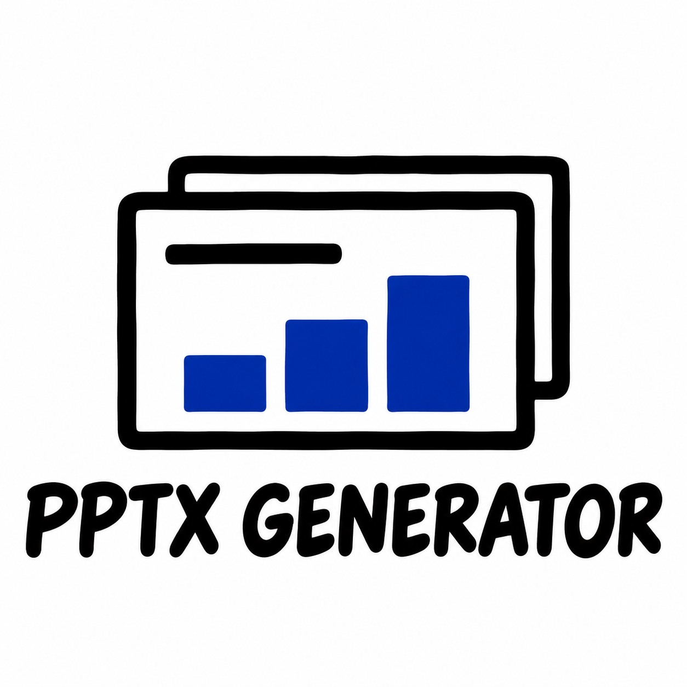

<p align="center">
  
</p>

# PPTX Generator

**在 Codex 里选风格、排版式，把论文、研究图表和提纲做成可编辑的 PowerPoint。**

PPTX Generator 适合组会、文献汇报、学术会议和论文答辩，也可以从现有的 PowerPoint 模板开始制作。浏览器预览把 27 套风格色卡和 L1–L16 的 16 张单页版式示意放在同一页。

## 安装到 Codex

在 Codex 聊天中发送这条指令。

```text
$skill-installer 安装 https://github.com/QING1105/pptx-generator/tree/main/skills/pptx-generator
```

也可以使用 Skills CLI（需要 Node.js 22.20 或更新版本）。

```bash
npx skills add QING1105/pptx-generator --skill pptx-generator -a codex -g -y
```

## 使用

安装完成后，在 Codex 的下一轮对话中输入。

```text
$pptx-generator 用这篇论文和我上传的图表做一份 12 分钟的中文组会 PPT。
```

开始制作前，Codex 会请你选一种方式。

| 方式 | 适合的情况 | 接下来会怎么做 |
| --- | --- | --- |
| **1 · 已有提纲，直接生成** | 已经写好目录、讲稿提纲或逐页内容 | 导入、整理、校验提纲，然后生成 PPT |
| **2 · 苏格拉底式问答，生成提纲** | 手头有材料，想一起梳理讲述主线 | 从听众和汇报目标开始，逐轮讨论每节讲什么、用哪张图，确认逐页提纲后生成 PPT |

你也可以在第一条消息里直接指定方式。已有 PowerPoint 模板时，可以一起提供。

```text
$pptx-generator 选方式 1，用我上传的 PPTX 作模板，按已有提纲和图表做一份论文答辩 PPT。
```

## 从材料到 PowerPoint

1. **提供材料。** 发论文、讲稿、提纲或实验图表，告诉 Codex 汇报场合、时长和语言。
2. **看预览、选风格。** 在同一页查看色卡与所有单页版式。可以回复「S1，封面用 L1，方法页用 L12」，也可以让 Codex 按内容安排版式。
3. **保存逐页提纲。** 两种方式都生成 `outline.json`，其中包括报告标题、目录、各页内容和图表来源、全稿及分章排版要求、单页版式和讲述要点。
4. **生成和修改。** 按同一份 JSON 生成可编辑的 `.pptx`。改稿时可以先更新 JSON。章节重排后，目录和页序会随新版提纲一起更新。

[查看可编辑的 JSON 示例](skills/pptx-generator/references/outline.example.json) · [查看字段和改稿规则](skills/pptx-generator/references/outline-workflow.md)

| 预览内容 | 编号 | 示例 |
| --- | --- | --- |
| 瑞士风格 | S1–S4 | S1 克莱因蓝，简洁的无衬线排版 |
| 杂志风格 | M1–M5 | M2 靛蓝瓷，衬线标题和浅色底 |
| Office 配色 | O1–O18 | O15 纯技蓝调，适合技术和研究汇报 |
| 单页版式 | L1–L16 | L1 全幅封面、L6 四格、L12 流程图、L14 甘特图、L16 图文混排 |

## 更新

使用 Skills CLI 安装的用户可运行。

```bash
npx skills update pptx-generator
```

也可以在 Codex 中说「更新 pptx-generator 技能」。

## 常见问题

| 遇到的情况 | 处理方法 |
| --- | --- |
| 找不到 `$pptx-generator` | 开始下一轮对话。技能列表还未刷新时，重新打开 Codex。 |
| 预览页打不开 | 在原聊天里说「重新打开风格和版式预览」。预览用本机 Python 3 启动。 |
| 首次生成提示缺少依赖 | 生成需要 Node.js 20 或更新版本和 npm。技能首次生成时会在演示文稿项目里安装所需的 PptxGenJS。 |
| 想沿用单位的模板 | 上传现有 `.pptx`，并说明要保留哪些版式，替换哪些页。 |

瑞士和杂志风格参考改编自 [guizang-ppt-skill](https://github.com/op7418/guizang-ppt-skill)。[许可与署名](skills/pptx-generator/LICENSE)
